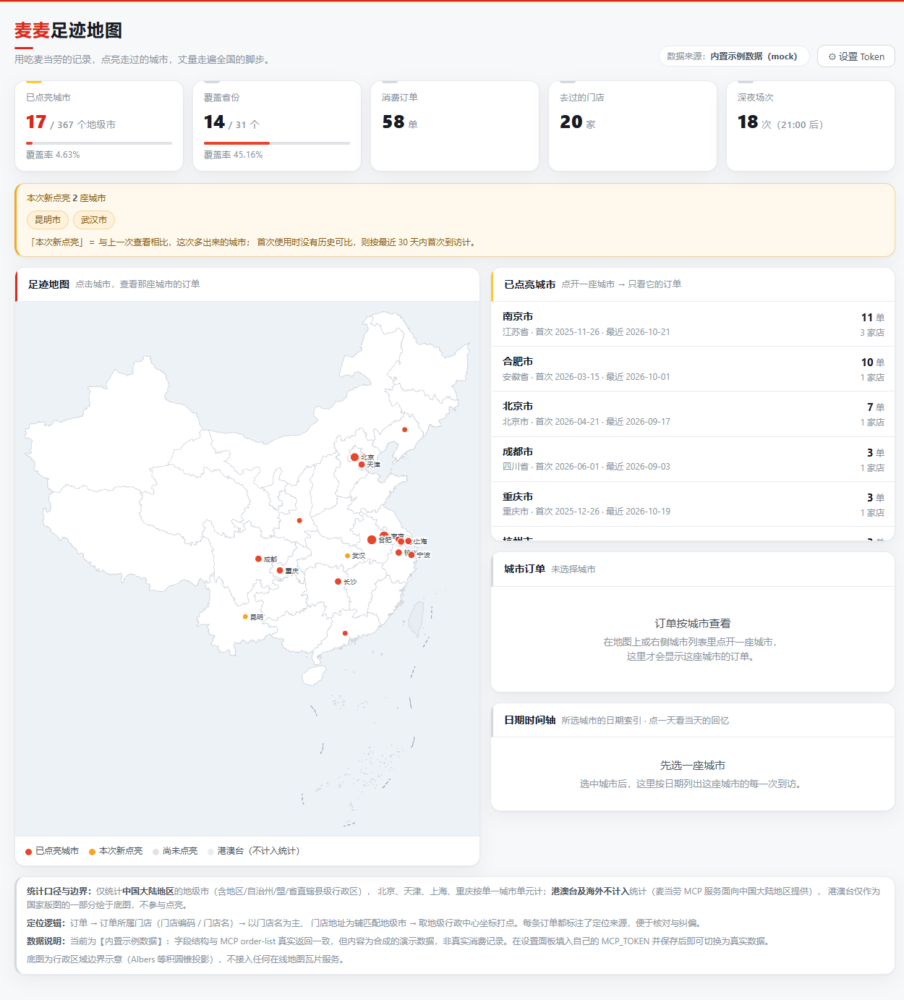
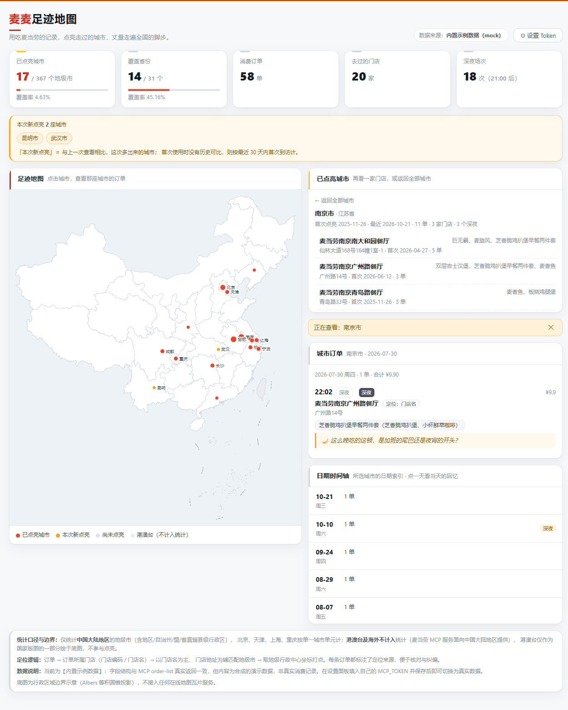

# 🍔 麦麦足迹地图（mcd-footprint-map）

> 用吃麦当劳的记录，点亮走过的城市，丈量走遍全国的脚步。

基于 **麦当劳中国 MCP** 的真实消费记录（`order-list` + `query-order`）构建的原创 Skill：
把每一笔麦当劳订单变成中国地图上的一点微光——去过哪座城、哪天在哪家店、点了什么、是不是深夜的那顿。

> ### 🔗 在线体验
> **https://mcd-footprint-map.app.workbuddy.host/?sharecode=AEY5PF5BYZ**
>
> 打开即是内置示例数据（58 单 / 17 城），无需 Token、无需安装。点地图上的城市或右侧城市列表，即可下钻到那座城市的门店、日期与当日回忆。
> 想接自己的真实订单，见下方「快速开始 · 方式零」。

---

## ✨ 它能做什么

| 能力 | 说明 |
| --- | --- |
| 🗺️ **地级市点亮** | 按地级市粒度在中国大陆地图上点亮去过的地方；北京/天津/上海/重庆按单一城市单元计 |
| 🎉 **新增城市高亮** | 与上一次运行比对，本次新点亮的城市用金色脉冲标记并在顶部提示 |
| 📊 **覆盖统计** | 已点亮城市数 / 367，覆盖省份数 / 31，以及各自的覆盖率 |
| 🕒 **日期时间轴** | 所选城市的日期索引：哪天去过、有没有深夜场（含追问预览），点一天看当天的回忆 |
| 🌙 **深夜回忆** | 21:00 及之后的记录，追加一句轻松克制的追问，如「那天那么晚在想什么呢？」 |
| 🔗 **城市 → 订单联动** | 默认只显示城市；点开一座城市后，才显示这座城市的订单与日期 |
| 🔑 **Token 可配置** | 页面右上角「⚙ 设置 Token」填写自己的 MCP_TOKEN，保存即生效 |

**默认视图只有城市**：地图点位 + 城市列表。订单不默认铺开——先选城市，再看这座城市的订单。
点开城市后可再点某家门店做二级筛选；顶部会显示「正在查看：城市 / 门店」。

### 📷 界面一览

| | |
| --- | --- |
|  |  |

> 左：默认视图——地图点亮与城市列表；右：点开一座城市后——门店列表、日期索引（含深夜追问预览）与当日回忆。

---

## 🚀 快速开始

### 方式零：本地服务（推荐 —— 可在页面里直接填写自己的 Token）

```bash
python -m mcd_footprint --serve --port 8765
```

浏览器打开 `http://127.0.0.1:8765`：

1. 右上角 **⚙ 设置 Token** → 粘贴你的 MCP_TOKEN → **保存并使用**；
2. 页面提示「✓ 保存成功」，并立即用你的 Token 重新拉取订单、刷新足迹；
3. Token 落盘在 `~/.mcd-footprint-map/token.json`（权限 600）。

也可以用命令行保存（不带参数会提示输入、不回显）：

```bash
python -m mcd_footprint --save-token          # 交互式输入
python -m mcd_footprint --save-token 你的Token  # 直接传入
python -m mcd_footprint --show-token           # 查看当前生效的 Token（脱敏）
python -m mcd_footprint --clear-token           # 清除
```

### 方式一：内置示例数据（无需 Token，30 秒看到效果）

```bash
git clone <your-repo>
cd mcd-footprint-map

python -m mcd_footprint --source mock --out out/footprint.html
```

然后双击打开 `out/footprint.html` —— **单文件、离线可用、零依赖**。

### 方式二：真实 MCP 数据（推荐）

1. 到 [麦当劳 MCP 开放平台](https://open.mcd.cn/mcp) 申请 MCP Token。
2. 配置（见 `mcp-config.example.json`，Token 走环境变量）：

```bash
export MCD_MCP_TOKEN=你的Token
```

3. 运行（`--source` 默认 `auto`：有 Token 就走 MCP，没有就用示例数据）：

```bash
python -m mcd_footprint --source mcp \
    --out out/footprint.html \
    --json-out out/footprint.json \
    --state out/state.json
```

首次运行会点亮全部已去过城市；之后每次运行，`--state` 会记录已知城市，
**只有新出现的城市才会被标记为「新点亮」**。

### 方式三：已有 JSON（例如 WorkBuddy 调用 MCP 后落盘）

```bash
python -m mcd_footprint --source file --input orders.json --out out/footprint.html
```

---

## 🧩 实际使用的 MCP 能力

| Tool | 用途 |
| --- | --- |
| `order-list` | 历史订单：门店名、下单时间、订单内容（主数据源） |
| `query-order` | 补齐 `storeAddress` 门店地址（`order-list` 不含该字段） |
| `now-time-info` | 取服务器日期，对齐「今天」的时区口径 |
| `query-nearby-stores` | 可选兜底：城市反查（默认关闭，`--probe-mcp`） |

接入方式：`https://mcp.mcd.cn`，Streamable HTTP，`Authorization: Bearer ${MCD_MCP_TOKEN}`。

> 详细的字段映射、实测缺口与降级方案见 [`docs/CAPABILITY_MATRIX.md`](docs/CAPABILITY_MATRIX.md)
> 与 [`MCP_INTEGRATION.md`](MCP_INTEGRATION.md)。

---

## 🧭 能力边界与降级

MCP 接口的实测限制与对应的处理方式：

| 限制（实测） | 处理方式 |
| --- | --- |
| `order-list` **不返回**城市 / 地址 / 经纬度 | 用 `query-order.storeAddress` 补地址；城市走多级推断 |
| 部分历史订单 `query-order` 返回 `610303 订单号不存在！` | 容错跳过，退化为门店名推断，日志记录 `enrich_failed` |
| `query-nearby-stores` 的 `longitude`/`latitude` **恒为 `0.0`**，无法打点 | 坐标使用**地级行政中心坐标查表**（源自官方行政区划数据 `center` 字段） |
| `order-list` **无分页参数**，历史深度受限（实测 10 条） | 记录 `order_list_count`；支持 `--source file` 导入更完整历史 |
| 港澳台及海外不在 MCP 服务范围 | **不计入统计**；底图仍完整绘制国家版图 |

城市推断的降级链（结果里会记录 `city_source`，可追溯）：

```
L1 人工纠偏表      storeCode / 门店全名精确匹配        置信度 1.00
L2 门店名（锚定开头） 麦当劳<城市><商圈/路名>餐厅       置信度 0.90
L2' 门店名（最靠前）  兜底                            置信度 0.75
L3 门店地址        必须显式出现「<城市名>+市」          置信度 0.85
L4 MCP 反查        query-nearby-stores（默认关闭）     置信度 0.70
L5 无法判定        计入 unresolved，不点亮            置信度 0.00
```

> 为什么 L3 要求「市」字？实测门店地址多为「路名+门牌号」，
> 「广州路14号」「中山路166号」「延安路98号」若不加约束会被误判成广州市/中山市/延安市。

想确认当前数据能不能 100% 定位？跑一遍体检：

```bash
python tools/audit_geolocation.py --source mock    # 或 --source mcp
```

它会逐条订单打印**定位来源分布**、解析成功率，以及无法定位的门店清单
（可据此回填 `data/city-overrides.json`）。退出码 0 表示全部订单都能定位。

---

## 🗺️ 统计口径与边界

- **范围**：仅 **中国大陆地区**，粒度为**地级市**（含地区 / 自治州 / 盟 / 省直辖县级行政区），共 **367** 个统计单元；省级行政区 **31** 个。
- **直辖市**：北京、天津、上海、重庆各计 1 个城市单元，不再细分市辖区。
- **港澳台及海外：不计入统计**（麦当劳 MCP 服务面向中国大陆地区提供）。
  港澳台仅作为国家版图的组成部分绘于底图（灰色），不点亮、不计数。
- **深夜定义**：下单时间 ≥ 21:00。

## 🗺️ 地图合规

- 底图为**行政区域边界示意图**，Albers 等积圆锥投影，**离线本地渲染**，
  **不接入任何在线地图瓦片服务**，无需任何地图 Key。
- 边界数据来自阿里云 DataV.GeoAtlas 行政区划数据（源自民政部行政区划数据）。
- 版图绘制遵循国家标准：完整绘制台湾省，并保留九段线要素。
- 若需正式出版或商业用途，建议改用自然资源部标准地图服务或天地图的审图号数据。

---

## 📁 目录结构

```
mcd-footprint-map/
├── README.md                    # 项目介绍（必需）
├── CONTEST_DECLARATION.md       # 参赛声明（必需，内容不可改动）
├── MCP_INTEGRATION.md           # MCP 集成说明（必需）
├── mcp-config.example.json      # 脱敏 MCP 配置（仅环境变量占位符）
├── workbuddy.md                 # WorkBuddy 开发上下文
├── SKILL.md                     # Skill 入口定义
├── src/mcd_footprint/
│   ├── cli.py                   # 命令行入口（--serve / --save-token 等）
│   ├── pipeline.py              # 取数→归一化→解析→聚合→时间轴（CLI 与服务共用）
│   ├── config.py                # MCP_TOKEN 本机持久化
│   ├── server.py                # 本地服务：页面 + Token 接口（仅标准库）
│   ├── mcp_client.py            # MCP Streamable HTTP 客户端
│   ├── sources.py               # mcp / file / mock 三种数据源
│   ├── normalize.py             # 订单归一化
│   ├── cities.py                # 城市解析（多级降级）
│   ├── aggregate.py             # 地级市聚合与统计
│   ├── narrative.py             # 时间轴 / 当日回忆 / 深夜追问
│   └── render.py                # 单文件 HTML 渲染
├── assets/viewer.html           # 页面模板（内联 CSS/JS，无外部依赖）
├── data/
│   ├── china-outline.json       # 省级行政边界（简化）
│   ├── city-centroids.json      # 地级市中心坐标（367 个单元）
│   ├── city-overrides.json      # 人工纠偏表
│   └── sample-orders.mock.json  # 示例数据（结构真实、内容合成）
├── tools/
│   ├── build_geo_data.py        # 构建地理数据
│   ├── generate_mock_data.py    # 生成示例数据
│   └── audit_geolocation.py     # 定位链路体检
├── tests/
│   ├── test_pipeline.py         # 单元验证（python -m unittest discover -s tests）
│   └── ui_smoke.js              # 页面交互冒烟（需 jsdom，可选）
└── docs/
    ├── CAPABILITY_MATRIX.md     # MCP 能力清单与字段映射
    ├── SELF_CHECK.md            # 对照评审标准的自检
    ├── NEW_IN_THIS_ROUND.md     # 本次改动说明
    └── images/                  # README 界面截图
```

> 本轮新增/改动了什么、为什么需要，见 [`docs/NEW_IN_THIS_ROUND.md`](docs/NEW_IN_THIS_ROUND.md)。

---

## ✅ 最小验证步骤

```bash
# 0) 环境：Python 3.9+（仅标准库，无第三方依赖）
python --version

# 1) 冒烟：示例数据跑通全链路
python -m mcd_footprint --source mock --out out/footprint.html --json-out out/footprint.json
# 期望：输出 "[out] 写出 HTML -> out/footprint.html"

# 2) 单元验证
python -m unittest discover -s tests -v
# 期望：OK（17 项：城市解析、Token 存储、服务、城市-订单联动、渲染转义…）

# 3) 定位链路体检
python tools/audit_geolocation.py --source mock
# 期望：可定位 100%，退出码 0

# 4) 真实 MCP（需 Token）
python -m mcd_footprint --save-token 你的Token
python -m mcd_footprint --source mcp --out out/footprint.html

# 5) 本地服务 + 页面内设置 Token
python -m mcd_footprint --serve --port 8765

# 6) 查看产物：双击 out/footprint.html
```

页面交互冒烟（可选，需 Node + jsdom）：

```bash
npm install jsdom
node tests/ui_smoke.js out/footprint.html server   # 或 offline
# 覆盖：默认不显示订单 → 点城市才显示 → 保存 Token 的反馈
```

---

## 🎯 目标用户

- 常年出差 / 旅行，想直观看到自己去过多少城市的麦当劳爱好者
- 想给自己的「麦麦生涯」做一份年度回顾的人
- 对「用真实消费数据做地理可视化」感兴趣的开发者

---

## 📄 许可与声明

- 本项目为「麦当劳程序员节创意开发大赛」参赛作品，由参赛者独立开发，**非麦当劳官方产品**。
- 参赛声明见 [`CONTEST_DECLARATION.md`](CONTEST_DECLARATION.md)。
- 餐品信息、价格及供应状态以麦当劳官方渠道的实时结果为准。
- 仓库内不含 Token、密钥或个人敏感信息。
